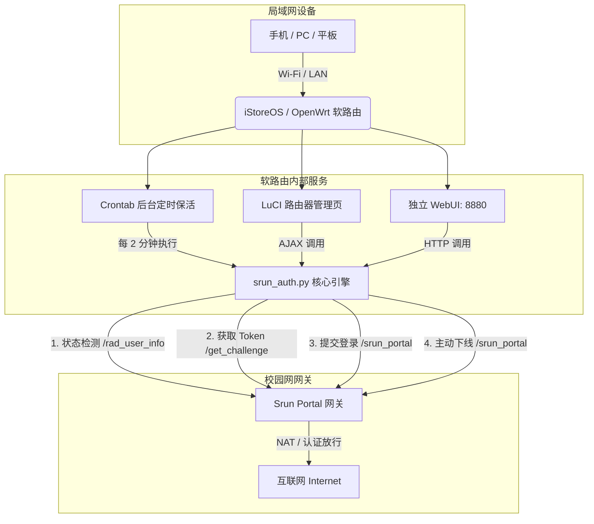

# CUP Srun Campus Network Auto-Auth & WebUI
### 中国石油大学（北京）校园网 Srun 自动认证与 Web 管理工具

[](https://openwrt.org/)
[](https://www.python.org/)
[](LICENSE)

专为部署在 **OpenWrt / iStoreOS** 等软路由与 Linux 网关设备的深澜（Srun3000 / Srun4000）校园网自动登录、后台保活与可视化管理套件。

解决校园网频繁掉线、设备数限制、重启软路由无法联网等痛点。全屋设备通过路由器连网，统一走软路由自动认证出网。

---

## 🌟 特性一览

- ⚡ **无感自动登录**：开机自动认证，网络掉线或下线后定时任务秒级探测并自动重连。
- 🖥️ **双前端管理界面**：
  - **LuCI 界面原生集成**：无缝融入 iStoreOS / OpenWrt 路由器后台（`服务 -> 校园网认证`）。
  - **独立轻量 WebUI**：监听 `8880` 端口，手机或电脑浏览器直接打开管理，无需暴露路由器 root 密码。
- 🚪 **全流程生命周期管理**：支持在线状态实时监测、一键立即认证、一键注销下线。
- ⚙️ **动态配置无需重启**：Web 界面随时修改学号、密码与检测频率，即刻生效写入底层脚本。
- 🛡️ **轻量安全与内存保护**：纯 Python 标准库编写（无需额外 pip 依赖）；内置 500 行日志滚动保护，防止 OpenWrt 内存盘（tmpfs）占满。
- 📦 **开箱即用一键脚本**：提供一键安装与卸载 Shell 脚本，一键完成开机服务与 Crontab 注册。

---

## 🏗️ 架构与工作流程



---

## 🚀 快速安装部署

### 方式 1：一键快速安装（推荐）

通过 SSH 登录到你的 OpenWrt / iStoreOS 路由器终端，执行以下命令：

```bash
# 1. 克隆或下载本项目
git clone https://github.com/YOUR_GITHUB_USERNAME/cup-srun-login.git /tmp/cup-srun-login

# 2. 进入目录并执行一键安装
cd /tmp/cup-srun-login
chmod +x install.sh
./install.sh
```

> [!TIP]
> 安装脚本会自动检测 `python3` 环境；若缺少将自动通过 `opkg` 安装。

---

### 方式 2：手动部署

如果你更倾向于手动分步部署，可将项目文件拷贝至对应路径：

```bash
# 1. 复制核心程序
mkdir -p /usr/local/bin
cp bin/srun_auth.py /usr/local/bin/srun_auth.py
cp bin/srun_webui.py /usr/local/bin/srun_webui.py
chmod +x /usr/local/bin/srun_auth.py /usr/local/bin/srun_webui.py

# 2. 配置 WebUI 开机启动服务
cp etc/init.d/srun_webui /etc/init.d/srun_webui
chmod +x /etc/init.d/srun_webui
/etc/init.d/srun_webui enable
/etc/init.d/srun_webui start

# 3. 配置 LuCI 界面
mkdir -p /usr/lib/lua/luci/controller
mkdir -p /usr/lib/lua/luci/view/srun
cp luci/controller/srun.lua /usr/lib/lua/luci/controller/srun.lua
cp luci/view/srun/index.htm /usr/lib/lua/luci/view/srun/index.htm
rm -f /tmp/luci-indexcache*

# 4. 配置后台保活定时任务 (每2分钟检测一次)
(crontab -l 2>/dev/null | grep -v "srun_auth.py"; echo "*/2 * * * * /usr/bin/python3 /usr/local/bin/srun_auth.py >/dev/null 2>&1") | crontab -
/etc/init.d/cron restart
```

---

## 📖 使用指南

### 1. 独立 Web 管理端（端口 8880）
安装完成后，在同一局域网的任意浏览器中访问：
```text
http://<路由器IP>:8880
```
- **首次使用**：在「⚙️ 账号配置」卡片中输入你的学号与校园网密码，点击「💾 保存配置」。
- **状态卡片**：查看是否在线、当前分配的内网 IP 与已登录用户名。
- **手动操作**：点击「🔑 立即认证」直接上线，或「🚪 注销下线」主动断开网络连接。

### 2. LuCI 管理界面
登录 iStoreOS 后台，左侧导航栏：
```text
服务 -> 校园网认证
```
- 提供账号密码编辑、检测保活任务开关、自定义保活时间（1~1440分钟）、实时认证终端日志查看。

### 3. 命令行（CLI）调试
你也可以直接在 SSH 终端通过命令行与认证核心交互：

```bash
# 检查当前网络状态（返回 ONLINE <用户名> <IP> 或 OFFLINE）
python3 /usr/local/bin/srun_auth.py --status

# 主动注销当前设备下线
python3 /usr/local/bin/srun_auth.py --logout

# 运行一次检测与自动保活登录
python3 /usr/local/bin/srun_auth.py

# 查看实时运行日志
tail -f /var/log/srun_auth.log
```

---

## 📂 仓库目录结构

```text
.
├── README.md               # 项目主说明文档
├── LICENSE                 # MIT 开源授权协议
├── install.sh              # 一键自动安装脚本
├── uninstall.sh            # 一键完全卸载脚本
├── bin/
│   ├── srun_auth.py        # 认证核心引擎（加解密、保活与状态探测）
│   └── srun_webui.py       # 独立轻量 WebUI 服务（Port 8880）
├── etc/
│   └── init.d/
│       └── srun_webui      # OpenWrt procd 守护进程与开机自启脚本
├── luci/
│   ├── controller/
│   │   └── srun.lua        # LuCI 路由与后端逻辑控制器
│   └── view/
│       └── srun/
│           └── index.htm   # LuCI 卡片式响应式前端页面
└── docs/
    └── protocol.md         # 深澜 Srun 协议分析与加密细节技术备忘
```

---

## 🗑️ 卸载

若需彻底清理并移除该认证服务，只需执行：

```bash
chmod +x uninstall.sh
./uninstall.sh
```

---

## 📄 协议解析与技术备忘

深澜 Srun Portal 的加密过程涉及：
1. 动态获取 Challenge Token 作为 Nonce 盐值；
2. 采用类 XXTEA 变种对称分组加密算法（`xencode`）加密用户信息字典，再经特殊字符表的自定义 Base64 编码构造 `{SRBX1}` 串；
3. 密码经 HMAC-MD5 加密；
4. 拼接 Token、用户名、密码摘要、IP、acid 等字段计算 SHA1 校验和。

详细的前端逆向与协议分析可参考 [docs/protocol.md](docs/protocol.md)。

---

## ⚠️ 免责声明

1. 本项目仅供网络技术学习、软路由运维研究以及校园网网络连通性优化使用。
2. 请遵守中国石油大学（北京）校园网网络安全与使用规范，严禁用于任何破坏网络秩序或非法用途。

---

## 📜 许可证

本项目采用 [MIT License](LICENSE) 开源。欢迎提交 Issue 与 Pull Request！
