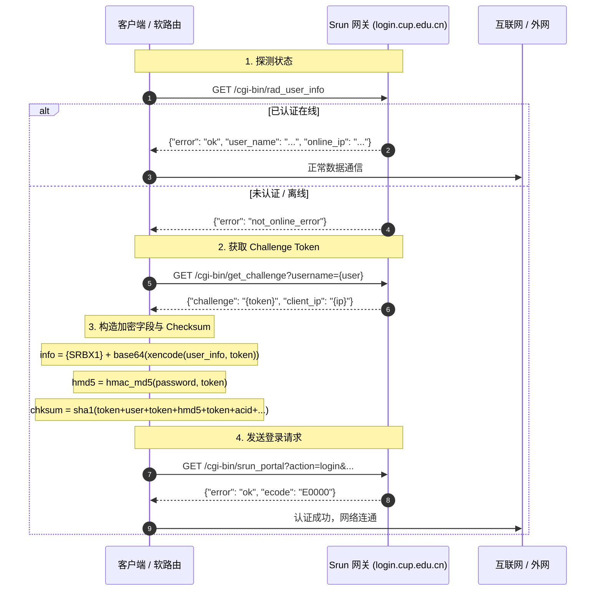

# 深澜（Srun3000 / Srun4000）Portal 认证协议技术解析

本文档记录针对中国石油大学（北京）校园网深澜（Srun）认证网关的前端逆向与协议细节。

---

## 一、 认证交互总体时序



---

## 二、 关键加密与算法细节

### 1. Challenge Token 与 Client IP
- 请求地址：`https://login.cup.edu.cn/cgi-bin/get_challenge?callback=cb&username={USERNAME}&ip=&_={TIMESTAMP}`
- 响应结构：
  ```json
  {
    "challenge": "4fa92d...", 
    "client_ip": "10.4.18.206",
    "ecode": 0,
    "error": "ok"
  }
  ```
- **关键点**：`challenge` 作为后续对称加密与 HMAC 的单次动态秘钥（Nonce），有效防止重放攻击。

### 2. 字段对称加密（`srun_bx1` + 自定义 Base64）
- 原始 JSON 字串（必须使用紧凑无空格序列化）：
  ```json
  {"username":"<学号>","password":"<密码>","ip":"<client_ip>","acid":"1","enc_ver":"srun_bx1"}
  ```
- 加密步骤：
  1. **`xencode(raw_json, token)`**：深澜专有的类 XXTEA 变种对称分组加密算法；
  2. **自定义 Base64 编码**：使用定制字符表：
     `LVoJPiCN2R8G90yg+hmFHuacZ1OWMnrsSTXkYpUq/3dlbfKwv6xztjI7DeBE45QA`；
  3. 最终加上 `{SRBX1}` 前缀。

### 3. 密码摘要（HMAC-MD5）
- 算法：`hmac.new(token.encode('utf-8'), PASSWORD.encode('utf-8'), hashlib.md5).hexdigest()`
- 结果为 32 位十六进制 MD5 散列值。

### 4. 校验和（`chksum`）计算规则（避坑要点）
- 拼接字符串：
  ```text
  chkstr = token + USERNAME + token + hmd5 + token + AC_ID + token + ip + token + "200" + token + "1" + token + info_encoded
  ```
- 计算 SHA1：
  ```python
  chksum = hashlib.sha1(chkstr.encode('utf-8')).hexdigest()
  ```
> [!WARNING]
> 在参与 `chksum` 拼装时，`hmd5` **绝对不能包含 `"{MD5}"` 前缀**！  
> `"{MD5}"` 前缀仅在最后向 `/cgi-bin/srun_portal` 提交请求的 `password` GET 参数中需要带上。若在校验和中加入会导致网关返回 `sign_error`。

---

## 三、 注销下线（Logout）协议

向 `/cgi-bin/srun_portal` 发送注销请求：
```text
GET https://login.cup.edu.cn/cgi-bin/srun_portal?callback=cb&action=logout&username={username}&ac_id={acid}&ip={ip}&_={timestamp}
```
响应格式：
```json
{
  "client_ip": "10.4.18.206",
  "ecode": 0,
  "error": "ok",
  "res": "ok"
}
```
下线后，网关立即解除对该 IP 的计费和出网权限，客户端在下一次轮询中将检测为未认证状态。
